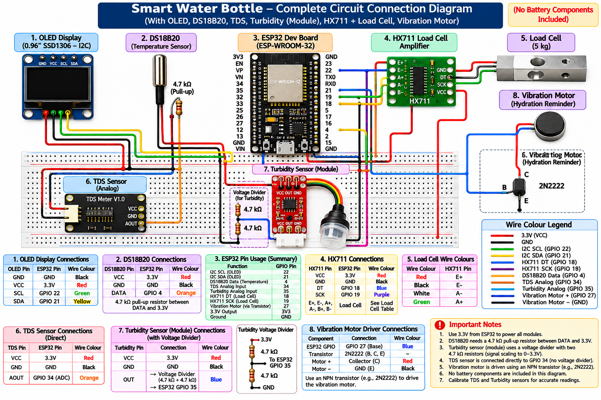

# Smart Water Bottle – IoT-Based Water Monitoring Prototype

An ESP32-based smart water monitoring prototype integrating multiple sensors to monitor water-related parameters and provide real-time information through an OLED display.

---

## Project Overview

The Smart Water Bottle is an embedded systems project designed to explore smart water monitoring through sensor integration and microcontroller-based processing.

The prototype uses an ESP32 microcontroller to collect sensor readings, process the measurements and display information through an SSD1306 OLED display.

It focuses on monitoring water temperature, Total Dissolved Solids (TDS), turbidity and weight, along with temperature-based alerts and hydration reminders.

## Project Objectives

- Develop an ESP32-based smart water monitoring prototype.
- Integrate multiple sensors for water-related measurements.
- Display sensor readings through an OLED interface.
- Implement temperature-based warning mechanisms.
- Explore weight measurement using a load cell.
- Implement hydration reminders.
- Establish a foundation for future water-quality monitoring enhancements.

## Features

- Real-time water temperature monitoring.
- Temperature-based warning messages.
- TDS measurement with estimated ppm calculation.
- Turbidity sensor voltage and ADC monitoring.
- Weight measurement using a load cell and HX711 amplifier.
- OLED-based information display.
- Hourly hydration reminder through the OLED.
- Serial Monitor-based load-cell calibration.

## Technologies Used

| Category | Technologies |
|---|---|
| Microcontroller | ESP32-WROOM-32 |
| Programming Language | Embedded C/C++ |
| Development Environment | Arduino IDE |
| Display | SSD1306 OLED |
| Temperature Sensor | DS18B20 |
| Water Quality Sensors | TDS and Turbidity |
| Weight Measurement | 5 kg Load Cell + HX711 |
| Communication | I2C, OneWire, Analog Input |

### Software Libraries

- Arduino.h
- Wire.h
- Adafruit_GFX
- Adafruit_SSD1306
- OneWire
- DallasTemperature
- HX711

## Hardware Components

| Component | Purpose |
|---|---|
| ESP32-WROOM-32 | Main processing unit |
| SSD1306 OLED | Display interface |
| DS18B20 | Water temperature monitoring |
| TDS Sensor | Total Dissolved Solids estimation |
| Turbidity Sensor | Water cloudiness-related sensing |
| Load Cell | Weight measurement |
| HX711 | Load-cell signal amplification |
| Vibration Motor | Proposed physical hydration reminder |

## Circuit Diagram

The following diagram illustrates the proposed hardware connections and GPIO assignments for the prototype.



For detailed pin assignments and component information, refer to:

- [Pin Configuration](hardware/pin-configuration.md)
- [Hardware Components](hardware/components-list.md)

## Working Principle

The ESP32 acts as the central controller of the prototype.

1. The DS18B20 sensor measures water temperature.
2. The TDS sensor provides an analog voltage used to estimate TDS in ppm.
3. The turbidity sensor provides analog readings that are displayed as ADC values and voltage.
4. The load cell and HX711 module measure weight after calibration.
5. The ESP32 processes the sensor readings.
6. The OLED displays the information through multiple screens.
7. The firmware activates an hourly hydration reminder.

## OLED Display

The OLED interface contains six rotating screens:

| Screen | Information |
|---|---|
| 1 | Water Temperature |
| 2 | Weight Measurement |
| 3 | Battery Percentage Demonstration |
| 4 | TDS Reading |
| 5 | Turbidity Reading |
| 6 | Daily Water Goal |

The display also presents temperature warnings and hydration reminders.
## Project Demonstration

Watch the Smart Water Bottle prototype in action.

[▶ Watch Demonstration](https://youtube.com/shorts/xD6jFmAk1aY)

## Testing and Results

The prototype underwent component-level testing.

| Component | Testing Observation | Status |
|---|---|---|
| ESP32 | Firmware uploaded and executed | Passed |
| OLED | Display initialization and navigation | Passed |
| DS18B20 | Normal and hot water testing | Tested |
| TDS Sensor | Analog voltage readings obtained | Tested |
| Turbidity Sensor | ADC and voltage readings obtained | Tested |
| Load Cell + HX711 | Weight measurement and calibration completed | Completed |
| Vibration Motor | Driver installation and motor testing pending | Pending |

A temperature reading of approximately 28.5°C was observed during normal water testing.

Further TDS and turbidity calibration is required to validate measurement accuracy.

## Repository Structure

```text
Smart-Water-Bottle/
│
├── hardware/
│   ├── circuit-diagram.png
│   ├── components-list.md
│   └── pin-configuration.md
│
├── documentation/
│   ├── project-overview.md
│   ├── working-principle.md
│   ├── testing-results.md
│   └── limitations-and-future-scope.md
│
├── README.md
└── SmartBottle.ino
```

## Installation and Setup

### Requirements

- Arduino IDE
- ESP32 board package
- ESP32-WROOM-32 development board
- Required hardware components
- USB cable for programming

### Required Libraries

Install the following libraries through the Arduino IDE Library Manager:

1. Adafruit GFX Library
2. Adafruit SSD1306
3. OneWire
4. DallasTemperature
5. HX711

### Steps to Run

1. Clone or download this repository.
2. Open `SmartBottle.ino` in Arduino IDE.
3. Install the required libraries.
4. Select the appropriate ESP32 development board.
5. Connect the hardware according to the pin configuration.
6. Select the correct COM port.
7. Compile and upload the firmware.
8. Open Serial Monitor at 115200 baud.

### Load Cell Calibration

- Send `t` through Serial Monitor with the platform empty.
- Place the known reference weight.
- Send `c` to perform calibration.

**Important:** The reference weight configured in the firmware must match the actual calibration weight.

## Limitations

- TDS measurement requires calibration using reference solutions.
- Turbidity is currently displayed as ADC and voltage readings, not calibrated NTU.
- Battery percentage is currently a demonstration value.
- Actual water consumption tracking is not implemented.
- Vibration motor functionality requires a suitable driver circuit.
- The prototype does not detect all chemical or biological contaminants.

## Future Scope

### Advanced Water Quality Monitoring

Explore additional sensors for pH, total hardness, chloride, sulphate, iron, fluoride, nitrate and arsenic.

### Hydration Tracking

Implement actual water consumption calculations, remaining-water measurement and daily hydration progress.

### Battery Management

Introduce battery voltage monitoring, percentage calculation and power optimization.

### City-Level Digital Twin Concept

Explore a city-level Digital Twin concept to compare regional water-quality parameters, such as Chennai and Bangalore, against relevant BIS drinking-water standards.

This is a proposed future research direction and is not implemented in the current prototype.

### Connectivity and Data Visualization

Explore wireless connectivity, historical data storage and remote monitoring.

## Detailed Documentation

- [Project Overview](documentation/project-overview.md)
- [Working Principle](documentation/working-principle.md)
- [Testing Results](documentation/testing-results.md)
- [Limitations and Future Scope](documentation/limitations-and-future-scope.md)
- [Hardware Components](hardware/components-list.md)
- [Pin Configuration](hardware/pin-configuration.md)

## Author

**Swarna Devika**

M.Sc. Data Science | VIT Chennai

GitHub: [SwarnaDevika](https://github.com/SwarnaDevika)

---

*This project demonstrates the integration of embedded systems, sensor interfacing and real-time monitoring for a practical water-monitoring application.*
